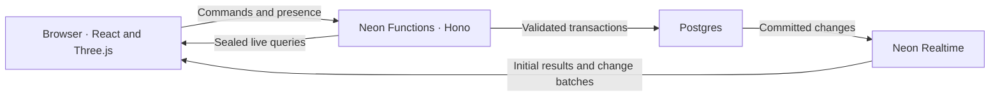

**Neon Bricks — launch plan and subsequent phases**

Drafted and reviewed 12 October 2026. Scope, performance targets, and effort estimates are planning assumptions; they have not been validated by a running implementation. The launch date is still to be set.

**Launch outcome.** A visitor opens a shared construction room, chooses a name and colour, and starts building within a minute. Other builders see their preview and committed edits. The room survives refreshes and reconnects. Two people can work on different sections at once, while Postgres prevents conflicting placements and stale edits from corrupting the model.

The product should feel like a miniature workshop: convincing plastic parts on a carefully lit tabletop, useful construction tools, and a mechanical starter model that invites people to extend it. The launch demonstrates three behaviours clearly: all shared state lives in Postgres, Neon Functions validate changes, and Neon Realtime carries the committed results to every browser.

**Launch scope.** The required scope is a collaborative static builder with mechanical parts. Working mechanisms, including a manual crank, belong to the next phase because they require joint state, movement envelopes, and shared control rules.

| Area | Required for launch | Optional after the required scope passes |
| --- | --- | --- |
| Joining | Backend-issued guest session, name, colour, room membership, shareable room URL | Named accounts and a gallery of saved worlds |
| Building | Place, rotate, recolour, move, delete, duplicate, select, multi-select, undo and redo of the visitor's own edits | Large reusable subassemblies and mirror tools |
| Parts | Approximately 36 curated shapes, including mechanical parts, with accurate dimensions and tested connection rules | More decorative shapes, transparent materials, larger plates |
| Collaboration | Visible builder previews, collaborator list, selection indicators, concurrent edits, conflict feedback | Follow another person's camera |
| Persistence | Automatic persistence of every committed edit; a room has no separate save step | Named snapshots and blueprint export |
| Presentation | Studio lighting, bevelled parts, soft shadows, polished palette, camera presets, presentation mode | Screenshot export and an elaborate sound library |
| Starter content | One carefully composed rover/workshop model and an empty-workbench option | Additional themed starter sets |
| Mechanics | Wheels, axles, beams, bearings, hinges, and gears that fit together in static assemblies | Additional static mechanical shapes |

Launch editing uses discrete positions and supported orientations. Builders can orbit the camera freely, but they cannot place arbitrary meshes at arbitrary transforms. Gravity, torque, structural load, motors, offline editing, and automatic conflict merging are outside the launch scope.

An accepted static assembly can contain floating parts. Connector snapping helps the visitor build plausibly, but launch does not enforce a global support graph. Removing a supporting brick leaves nearby parts where they are. Removing a part also removes its incident connection records in the same transaction.

Launch moves validate the destination pose. A dragged preview can pass through other geometry; it is not a physical movement simulation. Hinges have supported fixed poses and gears have authored static phase variants. Continuous articulation starts in the next phase.

**Reference demonstration.** The initial room contains a small rover beside a workbench, with open space around it. The rover showcases wheels, axles, beams, a coloured body, slopes, and visible gears. Visitors can add a roof, extend the chassis, construct a crane, or build a second vehicle. The starter model must use the same part definitions and validation path as visitor edits.

The release demonstration follows this sequence:

1. Open the room in two independent browser sessions and choose different colours.
2. Move a part preview in the first session; the second sees the builder's intent.
3. Add pieces in separate areas simultaneously; both edits succeed.
4. Place two bricks into the same empty space simultaneously; exactly one succeeds.
5. Move a small selected assembly; observers see the complete result together.
6. Undo one visitor's edit while preserving the other visitor's changes.
7. Refresh, join from a third device, and recover the current construction.
8. Enter presentation mode and admire the finished model.

Keep database and transport details in an optional demo inspector used by presenters. Normal building controls should describe the construction task. The inspector can show connection state, pending operations, and a committed operation's transaction ID without exposing queries or credentials.

**Initial technical choices.** Use TypeScript throughout, a Vite React frontend, React Three Fiber and Drei over Three.js, and Hono on Neon Functions. Use Drizzle for the schema, migrations, and ordinary typed queries, with node-postgres for connections. Use explicit SQL where the transaction and locking behaviour needs to be visible and controlled.

Host the static frontend separately, initially on Vercel. The browser calls Functions for commands and session operations, then subscribes directly to managed Neon Realtime for shared state. Begin with one backend Function containing the API. A scheduled cleanup trigger can invoke a separate route in that Function, using the trigger delivery verification supplied by the Functions runtime.

All shared authoritative state belongs in Postgres: worlds, identities and memberships, part instances, connections, presence, and operations. Camera positions, hover state, geometry caches, and interpolation remain local presentation state. Any state cached in a Function is disposable; another isolate must be able to handle the next request correctly.

**Provisioning and SDK compatibility.** Resolve these items in the first milestone, before adopting a setup recipe:

- Choose a compatible set of Realtime client, React integration, CLI, config, config-runtime, env, and Functions packages. Record their versions or source commits and the exact build commands.
- The inspected examples declare top-level `realtime` in `neon.ts`. The inspected `kevin-dp/realtime-config` and `kevin-dp/realtime-env-pull` branches declare `preview.realtime`. Select the form supported by the pinned package set and record it.
- The inspected examples create PG18 projects and explicitly enable logical replication. Confirm these prerequisites against the chosen release and use a dedicated demo project.
- Prefer `aws-eu-central-1` for an initially Europe-focused demo. Both Functions and Realtime list it as supported in the preview documentation. Reconsider the region if the launch audience is elsewhere.
- Configure the frontend's development, preview, and production origins for Realtime and for browser calls to Functions.
- Exercise the guest session flow from the actual frontend origin. Use a renewable, short-lived opaque bearer token for the initial direct-to-Functions integration, with its hash and expiry in Postgres. Retain the token in tab session storage across refreshes; issue a fresh viewer ID on every page load. An authenticated renewal extends the same session before expiry, preserving guest and viewer identities up to a configured maximum session age. Define the inactivity and maximum-age limits in M0. Expiry or revocation pauses editing and stops renewal; rejoining without a valid credential creates a new guest, with no access to the previous guest's undo history. Do not assume a cross-site cookie will work with the default Vercel and Function hostnames. Same-site custom domains and HTTP-only cookies are a later session-transport option.
- Verify how the deployed Function receives the Realtime sealing secret. Local env pull support does not prove deployed runtime injection. Keep the secret server-side and derive the subscription database name from the database connection configuration.
- Use pooled application connections through a small module-scoped `pg` pool with `attachDatabasePool`. Reserve the direct connection for migrations and operations requiring a database session. Interactive transactions must stay on one checked-out connection.
- Confirm a real deployed Function can commit a row and an independent browser can observe it through the chosen SDK. Exercise renewal beyond the initial 60-second capability lifetime and reconnection.

**Data model and invariants.** Use UUIDs for world, session, part, and operation identities. Store positions in exact integer construction units and orientations as supported discrete values. Define proxy tolerances and bucket layout separately, and verify that all supported collision and connector bounds map conservatively to the locked buckets.

| Record | Main fields and responsibility |
| --- | --- |
| `worlds` | ID, title, owner, dimensions, starter identifier, immutable catalogue/collision version, monotonic generation, lifecycle state, room settings |
| `guests` | Stable guest identity, display name, colour; retained across refreshes of an authenticated tab |
| `guest_sessions` | Session ID, guest ID, credential hash, renewable expiry, absolute expiry and revocation state |
| `world_memberships` | World and guest identity, role, admission state |
| `part_definitions` | Part key and version, dimensions, supported orientations, connector descriptions, collision description |
| `part_instances` | ID, world, part definition/version and supported variant, material/colour, integer position, orientation, monotonic revision, deleted timestamp, indexed collision and connector bounds |
| `part_connections` | Stable ID, world, two part/connector endpoints, connection type, monotonic revision, deleted timestamp, relevant connector slot |
| `connector_slot_claims` | Active connection and endpoint/slot references; unique world/part/connector/slot keys enforce exclusive capacity across either side of an edge |
| `spatial_buckets` | Persistent world/bucket keys covering empty and occupied regions; every geometric edit locks its collision and connector neighbourhood |
| `viewer_sessions` | Viewer ID, world, guest/session references, tool, selection, preview and its world generation, increasing sequence, server-written activity and expiry times |
| `build_operations` | World and generation, guest, operation ID, canonical request digest, accepted/rejected outcome, before/after part and connection data, result receipt, committed transaction ID for accepted edits, compensation links |
| `guest_world_history` | World and guest, active generation, ordered undo/redo entries and their effective expected versions; serialises history changes for that guest only |

The catalogue should have one versioned source that produces server validation data, client snapping data, and the database's part definitions. Rendering meshes may be procedural or asset-based, but they must agree with that source. A world pins a catalogue version so later geometry changes do not silently reinterpret an existing build.

Use composite references or equivalent constraints to keep parts and connections in the same world. Enforce exclusive connector slots with a unique endpoint/slot claim where the connector has capacity one. Define multi-connection shaft rules explicitly rather than giving every connector the same capacity.

Soft-delete parts and connections, retaining their IDs and monotonic revisions until the world is removed. Undo restores the same ID with a higher revision. Never recreate a deleted entity at revision zero or reuse its ID for a different entity; otherwise an old queued request could match a restored row and succeed. Reactivating a canonical connection advances its revision too, so a detach/reattach cycle cannot match stale expected topology. The scene query filters both kinds of tombstone out, and geometric occupancy and active connector-slot claims are released transactionally.

Index active parts by world and spatial bounds, connections by both endpoints, viewer sessions by world and expiry, and operations by world/guest and operation ID. Bound all scene queries to one world. Keep opaque credentials and full operation payloads outside live scene and presence queries.

Maintain these invariants:

- Accepted parts do not collide under the selected, documented collision model.
- Supported connector mating can occupy its intended clearance without being treated as a collision.
- Part state, connections, and the accepted operation receipt commit or roll back together.
- A command with an old part revision cannot overwrite a newer edit.
- A new command prepared against an earlier world generation cannot change the replacement model.
- Repeating an operation ID with the same payload returns its recorded terminal result, including a recorded placement rejection. Reusing it with a different payload fails.
- Access checks and authoritative validation run in Functions. Clients submit intended transforms; they do not supply trusted collision masks or connection records.
- Every geometry-changing command uses the same collision and lock protocol, including undo, redo, duplication, and assembly edits.
- Ordinary edits do not update a shared world revision, room counter, or per-world sequence under an exclusive lock. Attaching to different studs of one large baseplate must not exclusively lock that baseplate row.

Compute display counts through queries or derived UI data. Commands hold `FOR SHARE` locks on their authentication session, world lifecycle, and membership while executing, then recheck access. Use server time at that check for session expiry; a command admitted before expiry may finish its short transaction. Check generation for new operations after the receipt lookup, so an authorised retry can still obtain its original outcome. Session renewal/revocation, reset, expiry, and membership revocation use conflicting locks in the same order to establish a boundary with in-flight commands. `FOR KEY SHARE` alone would not block a non-key lifecycle update. Ordinary placement does not acquire an exclusive world lock. The initial join policy gives an authenticated guest editor membership when they join an open room through its link. Room closure and owner controls must have explicit API behaviour before public release.

**Collision and connection locking.** Use persistent spatial bucket rows and authored collision proxies for the mechanical launch catalogue. This protects both occupied space and empty connector neighbourhoods. A unique voxel claim alone cannot ensure two concurrently placed adjacent parts discover their new connection; their bodies may occupy different cells and neither part existed during the first lookup.

Precreate bucket rows for the bounded workbench when creating a world. Every placement, move, rotation, deletion, duplicate, undo, and redo locks the buckets covering its old and proposed collision bounds and connector interaction bounds, in sorted coordinate order. Include contact boundaries, snapping tolerance, and mating clearances so parts that might collide or connect share at least one bucket. The bucket layout and geometry rules are immutable for the world's version.

Use `READ COMMITTED` transactions. After acquiring all bucket locks, issue a separate candidate-read statement so it sees transactions that committed while the command waited. Do not reuse a pre-lock snapshot or put the candidate read into the same statement snapshot as lock acquisition. Check exact collisions and compatible connectors against that fresh candidate set.

Recheck affected part revisions and bounds after acquiring locks. A change to a caller's expected revision is a terminal conflict; do not silently replace it with the latest revision. If only a preliminary neighbour/bounds discovery changed, roll back and retry with the complete required bucket set; do not keep an incomplete set or append locks out of order. Hold the locks until the part, connection, and operation writes finish. An edit to a potential neighbour must follow the same protocol, including deletion and connection removal.

Exclusively lock rows of parts being changed, in UUID order, after bucket acquisition. Read unchanged anchors under the protection of the locked spatial neighbourhood and normal foreign-key checks; attaching a small piece must not take `FOR UPDATE` on an entire large baseplate. Recolouring an existing part can use its part-row revision check without spatial locks because it changes neither geometry nor connections.

This gives local serialization. Unrelated edits in one bucket may wait briefly; edits in disjoint bucket sets can proceed independently. A large assembly genuinely spanning many buckets will contend with edits in that area. All geometric writes must use this backend protocol. SQL uniqueness and foreign keys still enforce part identity, connector capacity, and referential integrity.

M0 must prove axle/bearing fits, pins in beam holes, stud connections, hinge poses, static gear phases, slopes, and arches. Choose a small set of compound collision primitives or precomputed masks for these supported transforms. Author the receiving clearances explicitly, use fixed numeric tolerances, and validate mutual collisions within multi-part placements as well as collisions with existing parts. The guarantee is against these authored proxies, not arbitrary triangle meshes or full physical simulation.

Measure bucket contention, candidate query cost, proxy validation cost, and a 100-part move before accepting the bucket size and catalogue. If a supported part cannot fit correctly, revise its proxy or restrict that pose before shipping. Voxel occupancy can be evaluated as a later optimisation, but is not a second launch implementation path.

**Command protocol.** Each edit carries an operation UUID, world ID and generation, catalogue version, intended changes, and expected revisions of existing affected parts. Moves and deletes also carry the expected incident connection IDs and revisions so a newly attached piece or detach/reattach cycle cannot be overlooked after the preview was prepared. New parts use client-generated UUIDs so the client can identify them if a response is lost. The backend derives identity from the verified guest session and checks the caller's membership.

| Command | Behaviour |
| --- | --- |
| Place | Lock the neighbourhood; validate part, transform, bounds, collisions, and connections; create instance and operation |
| Move or rotate | Check revisions and expected connections; validate the complete destination and recompute incident connections atomically |
| Recolour | Check revision and material choice; update the part and operation without spatial changes |
| Delete | Check revisions and expected connections; tombstone selected parts and remove incident connections atomically |
| Duplicate | Use the request's new part IDs; validate every copied part, mutual collisions, and internal/external connections |
| Edit selection | Apply one bounded multi-part transform or recolour as one operation |
| Undo or redo | Apply a validated compensating operation against the recorded affected parts and revisions |

The uniform lock order is authentication session, world lifecycle and caller membership in shared mode, the operation's deduplication record, the caller's world-history row, spatial buckets in coordinate order, and changed parts in UUID order. The history row establishes per-guest edit order across tabs without serialising different guests. Determine connection candidates after bucket acquisition. Canonicalise connection endpoint ordering, validate connector capacity, and activate or tombstone edges while the relevant spatial neighbourhoods remain locked. All command paths, including compensation, use this order.

Claim the unique `(world_id, guest_id, operation_id)` record before doing command work. Concurrent identical requests wait on that record and then read the existing receipt in a new statement. Canonicalise the complete request, including generation, new IDs and expected versions, for its digest. Store the accepted result, generation and original transaction ID in the edit transaction. Authorised retries of an old-generation operation can return its original receipt; new operations must match the active generation. Execute mutating validation under a savepoint so an ordinary domain rejection can roll back attempted edits and still commit a terminal rejected receipt. A deadlock or transport failure remains retryable; it is not a recorded geometry rejection. Never return the retry transaction's ID in place of the original accepted receipt.

Limit launch selection operations to 100 parts initially. Set a short lock-wait budget, use bounded retries for genuine database deadlocks, and return a domain conflict for occupied space or stale revisions. Finish the transaction before returning a committed transaction ID as a decimal string. Do not perform external calls while holding locks.

Keep a stable error vocabulary: occupied space, changed part or connections, replaced/closed world, invalid connection, outside build bounds, invalid part, forbidden action, and temporarily unavailable. Conflict responses should identify the relevant part or region sufficiently for the client to recover its preview. Maintain receipts and deduplication records for the world's retention period even when older undo payloads are compacted.

Undo identifies a specific accepted operation in the caller's history. Check the part revisions and relevant connection state against its recorded after-image. For example, undoing the creation of a brick must fail if another builder has since connected a new piece to it; it must not silently remove that new connection. Undoing a recolour changes only colour and preserves unrelated connections. Restoring a deletion must revalidate space and connector capacity and advance the retained part revision.

Undo and redo are new compensating transactions with their own operation IDs and receipts. Record their links to the original action. A failed compensation preserves the current world. A new ordinary edit clears that visitor's redo stack. Retain full payloads for the latest 100 editing actions per guest per world, including the data needed for their compensations; older receipts remain available for deduplication. Do not use the largest PostgreSQL transaction ID as an ordering or replay cursor, because allocation order is not commit order.

Maintain ordered undo/redo metadata in Postgres, under the per-guest history lock. Consecutive undo must account for revisions advanced by that guest's successful compensations: update the next eligible action's effective expected versions in the same transaction. Bridge to an earlier action only when the later action's recorded before-versions and restored relevant state match that earlier expectation; equal values alone do not prove that no intervening edit occurred. Redo uses the versions produced by undo, and another guest's changes remain conflicts. A generation change starts fresh undo/redo stacks while retaining old receipts.

**Optimistic state and recovery.** Keep authoritative subscribed rows and pending local operations separate. A pending placement appears immediately with a subtle visual distinction. A successful mutation response confirms the commit; `awaitTxId` confirms that the world subscription has caught up, and the local overlay can be removed.

Serialise pending commands that touch the same part while allowing commands on independent parts to proceed. Dragging updates only a preview; submit the final transform on release. Do not send a move or recolour for an unconfirmed new part using an invented revision.

- If the committed batch arrives before the API response, match it by part or operation ID and avoid creating a duplicate visual part.
- If placement loses a collision race, return the part to preview mode and identify the occupied area.
- If an API response is lost, look up the recorded receipt or retry the identical operation ID. A new placement after a rejected attempt uses a new ID. Reconcile against the latest subscribed part IDs and revisions; a subsequent edit may already have superseded the operation's after-image.
- If awaiting synchronization times out after a known commit, retain the committed operation as awaiting sync. A synchronization timeout is not a transaction rollback.
- On reconnect, accept the SDK's authoritative reset and rebuild the scene mapping. Raw subscription row identities are invalidated by a reset; keep selection and pending operations keyed by application part UUIDs.
- On a world-generation change, clear obsolete selection, previews and undo/redo UI; resolve old pending requests by receipt and discard their visual overlays. Never reapply an old-generation after-image to the replacement scene.
- When the world subscription is stale, retain the model and camera controls but pause new editing until the authoritative subscription recovers. Launch does not queue offline edits.
- Retain explicit knowledge of a successful deletion until its transaction has been observed; absence alone does not identify one particular operation.

Use the SDK's initial result as the authoritative starting snapshot. If the frontend preloads data over HTTP, treat it as provisional until the live reset reconciles it. Do not create a custom snapshot-plus-events sequence with an unprotected gap.

**Realtime subscriptions.** Use one browser client and one managed WebSocket. The authoritative scene is one deterministic query emitting a tagged world-header row plus part and connection rows, each with an entity kind, application ID, and typed payload. The header carries generation, catalogue version and lifecycle state even in an empty world. A `UNION ALL` view or equivalent query can project these records, filtered to active entities and the caller's access. M0 must verify this exact query shape against the pinned Realtime engine.

A single scene query provides one baseline and one change-batch boundary for generation, geometry and topology, including during reset and recovery. Keep viewer sessions and nonessential room metadata in separate small subscriptions. Load the immutable pinned catalogue before activating the scene. Keep lock rows, tombstones, and full operation history out of its regular feed.

Issue sealed queries in Functions after checking the session and room membership. All scene, presence and interface queries include membership admission and session-revocation restrictions, so committed revocation removes access through the live results. Session expiry denies renewal; an already issued capability may remain valid until its recorded `expiresAt`, currently at most 60 seconds after sealing. Verify this access boundary in M0 rather than putting `now()` into deterministic live SQL. Beta Realtime does not currently support RLS. The browser receives sealed queries, not database credentials or the sealing secret.

Use a materialized core subscription for the initial scene, with batch listeners and an explicit scene adapter. It supplies an authoritative snapshot and transaction tracking while the adapter applies incremental mesh changes. Implement a small shared renewal controller for this subscription using its actual `expiresAt`, fetching a fresh capability for the same query and renewing it. React's bindings can manage the smaller interface subscriptions with `refreshQuery`. Raw scene materialization is a later optimisation if memory measurements justify it.

Stage and apply all scene changes from a batch before drawing the next frame, and replace the entire scene mapping atomically on reset. The inspected SDK applies affected materialized subscriptions before batch listeners run, but independent subscriptions can reset at different times; that is why scene integrity uses one query. Verify multi-part edits, incident connection changes, and resets in the browser checks.

Show a compact live, reconnecting, or unavailable state. Retry recoverable transport errors through the SDK. Capabilities currently expire after 60 seconds, so renewal is part of the normal lifecycle and must be tested well beyond that interval.

**Presence.** Keep guest identity, authentication session, and viewer identity separate. Refresh retains the guest's authenticated session and undo identity, but creates a new viewer ID. A duplicated tab may share guest credentials; it still creates its own viewer record. The server binds each viewer to its authenticated session and membership. Use server-written timestamps and an increasing activity sequence to reject out-of-order updates.

| Behaviour | Initial policy |
| --- | --- |
| Preview updates | Send when the snapped transform or tool changes; cap at 5 per second and begin tuning at 2 per second |
| Held preview | Refresh its activity timestamp approximately once per second while the visitor is holding a placement, even when its transform is unchanged |
| Interpolation | Smooth remote markers and previews locally between published samples |
| Idle heartbeat | Approximately every 10 seconds while the room is foregrounded |
| Preview freshness | Fade a preview after approximately 3 seconds without a recent preview sample |
| Viewer presence | Mark inactive after approximately 30 seconds without any accepted heartbeat or activity update |
| Hidden tabs | Reduce activity traffic; allow expiry to represent an inactive tab |
| Cleanup | Scheduled deletion of long-expired records; if its record is missing, the client explicitly opens a new viewer ID |

The live query returns stored timestamps. Clients evaluate freshness against an estimated server clock, because deterministic live queries cannot filter on `now()`. Cleanup must delete only records still expired at deletion time so it cannot remove a newly refreshed viewer.

Presence updates modify an existing viewer row; they never implicitly upsert it. A delayed packet cannot recreate a viewer removed by cleanup or by leaving. Leaving deletes or closes the viewer and stops its timers. Heartbeats update presence expiry without refreshing an abandoned part preview. Estimate clock offset from a timestamped API response and request round-trip, then advance with a monotonic client clock so wall-clock adjustments do not rewind freshness.

Preview and selection updates carry the world generation and are rejected when it has changed. Render remote construction intent only when its generation matches the authoritative scene header, since presence can reset independently. Presenter reset clears stored previews and selections without resetting viewer sequence numbers or changing viewer identities.

Previews and selection indicators communicate intent; they do not reserve build space or grant editing ownership. A preview conflict does not block a placement that the database can accept. Keep markers small enough to preserve the model's readability and provide a way to hide collaborator overlays.

Presence can dominate database writes and network fan-out. Measure it independently from edit latency, keep its rows small, send only meaningful changes, and stop activity traffic after leaving a room. Reduce the update rate if the launch workload cannot meet its latency target.

**Part catalogue and construction controls.** The initial target is 36 distinct shapes. Dimensions and names remain provisional until the collision and connector proof passes.

| Family | Proposed launch shapes | Count |
| --- | --- | --- |
| Bricks | 1×1, 1×2, 1×3, 1×4, 2×2, 2×3, 2×4 | 7 |
| Plates | 1×1, 1×2, 1×4, 2×2, 2×4, 4×4 | 6 |
| Tiles | 1×1, 1×2, 2×2 | 3 |
| Shaped pieces | Two slopes, wedge, arch, window, round 1×1 | 6 |
| Mechanical pieces | Three beam lengths, pin, two axle lengths, bearing, wheel assembly, two gears, two hinge leaves, hub, crank handle | 14 |

Begin with 10–12 opaque colours. A part definition distinguishes permitted colours/materials, connectors, supported orientations, collision masks or proxies, and rendering details. Connector types include studs, receiving sockets, pin holes, axle holes, hinge pivots, and compatible gear interfaces. Capacity rules are connector-specific: a hole cannot accept two competing pins, while an axle may intentionally pass through several bearings.

Snapping chooses a candidate from a raycast surface or connector, rounds it to an allowed transform, and evaluates it against the latest local world. Show valid, conflicting, or awaiting-confirmation states using both shape/icon cues and colour. Functions repeat the authoritative checks.

Keep placement and camera gestures distinct. Provide visible keyboard shortcuts and clickable alternatives for rotate, cancel, delete, duplicate, and undo. Offer a height/layer control and a way to hide or ghost obstructing upper layers so builders can work inside a model. Begin with a simple layer filter rather than a full sectioning tool.

Launch multi-selection uses explicit selection, not automatic traversal of every connected piece. Moving a selection updates its internal connections and drops external connections that no longer fit. Recompute newly valid connections at the destination. Make this behaviour visible before committing the move.

Desktop and trackpad interaction are required. Smaller screens should display the model and support basic orbiting and inspection. Full touch editing is optional unless the launch audience requires it.

**Visual and rendering work.** Validate the visual direction early with six representative parts: a brick, slope, wheel, beam, axle, and gear. Review them together at normal building distance and close up, with a collaborator preview in the same scene.

| Element | Intended result |
| --- | --- |
| Geometry | Small bevels, rounded studs, believable wheel profiles and gear teeth; no visibly sharp primitive edges at the normal camera distance |
| Materials | Saturated moulded plastic with restrained roughness and highlights; a distinguishable axle material |
| Lighting | Warm key light, broad fill, soft contact shadows, and readable depth inside assemblies |
| Workbench | Quiet neutral surface, subtle construction grid, visible boundaries, and a composed backdrop |
| Camera | Useful initial framing, reliable orbit/pan/zoom, reset view, top/front/side presets, zoom-to-selection |
| Interface | Rendered palette thumbnails, clear selected part and dimensions, consistent controls, restrained green accents |
| Collaboration | Translucent part previews, small name markers, distinct selection indicators, concise conflict feedback |
| Presentation | Hide building overlays and frame the complete model without modifying shared construction state |

Instance repeated geometry, reuse materials, and update affected instance buffers instead of rebuilding the scene after every subscription change. Maintain a stable part-ID-to-instance mapping and handle selection and picking explicitly. Avoid putting frame-by-frame camera or preview interpolation into React state.

Choose shadow resolution and post-processing against a declared reference laptop and browser. Include a reduced-quality mode. Defer transparent parts until their sorting and instancing costs are understood. Test the selected rendering approach at several thousand parts before expanding the catalogue or adding visual effects.

**Milestones and work order.** The estimate assumes one experienced full-stack/Three.js engineer and prompt access to the unreleased packages. It includes custom mesh and collision-proxy authoring for the proposed catalogue, along with the transaction and recovery work described here; those assets do not exist yet. Work on catalogue assets and UI can overlap after the first milestone. Re-estimate once M0 establishes actual package, geometry, and rendering costs.

| Milestone | Work and concrete deliverables | Exit check | Initial effort |
| --- | --- | --- | --- |
| M0: Prove the foundations | Pin package set; document CLI build/setup; demonstrate deployed Function → Postgres → one scene query → two browsers; test mechanical fits, empty connector races, and bucket cost; compose six-part visual sample | Package/session flow and exact scene query work; locking/proxy proof and visual sample pass; no unresolved critical prerequisite | 2–4 engineering days |
| M1: Establish the authoritative model | Migrations; versioned catalogue format; renewable guest sessions and memberships; spatial locks; connection discovery; entity tombstones; world generations; terminal operation receipts; revision and topology checks | Collision, missing-connection, rollback, duplicate-request, stale-revision, and shared-baseplate checks pass against real Postgres | 4–6 days |
| M2: Build the construction experience | Scene adapter; palette; raycasting and snapping; placement and rotation; selection; move/recolour/delete/duplicate; layer controls; camera presets | One person can construct a small model using ordinary and mechanical parts without direct database access | 5–7 days |
| M3: Complete collaboration | Sealed scene query; renewal; optimistic overlays; viewer sessions; remote previews; response-loss/reset handling; conflict-aware undo/redo; bounded multi-part commands | The reference demonstration and compensation/recovery cases pass in independent browser sessions | 4–6 days |
| M4: Complete the launch presentation | Final catalogue; validated starter rover/workshop; lighting/material refinement; thumbnails; interaction polish; presentation mode; loading, empty, conflict, and unavailable states | Starter passes the validator; at least four of five representative new visitors join and place their first part within one minute without coaching | 4–6 days |
| M5: Qualify and release | Target-workload measurements; integration/browser checks; production configuration; room lifecycle policy; presenter runbook; release and recovery instructions | Correctness criteria pass; final advertised capacity meets the recorded performance envelope; deployment/recovery rehearsal passes | 3–4 days |

This gives a revised initial range of 22–33 engineering days. Package availability, mechanical geometry, and visual iteration are the largest sources of uncertainty. M0 is a dependency gate: resolve an unsupported scene query or an invalid mechanical fit before continuing. If the deadline is shorter, reduce catalogue breadth and optional features after preserving collision correctness, presence, and visual quality.

For a short launch deadline, keep a smaller coherent set of approximately 24 parts, one starter model, desktop editing, and a simple palette. Preserve basic multi-selection, small assembly moves, and per-visitor undo because they materially improve construction. Omit screenshots, sound polish, camera following, and extra starter sets first.

**Release acceptance criteria.** Correctness is a release requirement. Performance numbers are proposed targets to validate against the beta service, not promises about Neon.

| ID | Required evidence |
| --- | --- |
| A1: Persistent state | Refreshes and new sessions reconstruct identical part transforms, colours, and connections from database-backed state |
| A2: Collision race | Simultaneous requests for the same empty volume yield exactly one successful placement; rejected attempts leave no part/connection changes, while their complete rejection receipts persist |
| A3: Independent edits | Placements in disjoint bucket sets succeed without an exclusive world lock or shared edit counter; attaching to distant studs on one large baseplate does not exclusively lock its row |
| A4: Atomic scene edits | A multi-part move/duplicate either commits completely or preserves the previous model; part and connection changes, including authoritative resets, become visible as one consistent scene |
| A5: Mechanical fit | The catalogue's specified stud, pin, axle, bearing, hinge, and static gear combinations pass; incompatible connections and physical overlaps fail |
| A6: Revision conflicts | Competing edits cannot silently overwrite each other; stale requests fail after restoration of the same part ID and after a connection detach/reattach cycle |
| A7: Request recovery | Concurrent identical requests produce one terminal outcome; rejected operations remain rejected after space changes; retries of accepted operations return the original receipt and transaction ID; mismatched payloads fail |
| A8: Undo and redo | Consecutive undo/redo works on the same part across tabs sharing a guest; undo of a placement with a new third-party attachment conflicts; recolour undo preserves unrelated connections; occupied restore locations and reused connector slots conflict |
| A9: Renewal | Two sessions remain subscribed and receive mutations for at least ten minutes, across several capability renewals and at least one authenticated guest-session renewal |
| A10: Reconnection | A dropped transport and expired capability recover through an authoritative reset; pending operations reconcile without duplicates |
| A11: Presence lifecycle | Refresh retains guest/undo identity; tabs have distinct viewers; out-of-order updates do not rewind previews; held previews stay visible; idle heartbeats do not revive abandoned previews; late packets cannot recreate removed viewers or old-generation construction intent |
| A12: Room access | Commands and all sealed queries respect membership and role; session expiry, session revocation and membership changes enforce the documented access boundary |
| A13: Visual quality | Starter model, mechanical parts, shadows, preview states, and palette pass review at normal use distance and close up |
| A14: Interaction | Keyboard/mouse and trackpad paths work; there are clickable alternatives; camera controls do not accidentally place pieces |
| A15: Deployment | The real frontend and Functions deployment reproduce the reference demonstration with the production origin policy |
| A16: Connection races | Concurrent placement of new compatible neighbours records the expected edge regardless of commit order; connector-capacity competitors yield one valid winner; deletion/attachment races preserve the agreed connection state |
| A17: Measured capacity | The declared reference workload and final public capacity meet the recorded latency/rendering budgets; lower-quality mode and reduced-capacity behaviour are tested |
| A18: Room lifecycle | Closure, presenter reset and expiry cannot race an edit into a retired world; stale-generation requests fail, old receipt retries cannot alter the replacement scene, and reset publishes a coherent header/model without altering visitor rooms |

Use transaction integration tests for the database invariants and browser tests for the multi-user lifecycle. Add targeted unit tests for connector transforms, collision calculations, and command compensation where they protect these invariants. Visual review is appropriate for materials, lighting, and camera composition; tests should not mirror rendering implementation details.

Run at least 100 coordinated trials per database race with independent connections and varied commit order. Include intersecting rotations, move-versus-delete, empty-region placements, newly adjacent connectors, and footprints spanning bucket boundaries. Inspect locks during disjoint placements and attachments to one large baseplate. Include a multi-part command whose new parts collide with each other. Two browser tabs alone cannot prove these locking guarantees.

**Performance targets and capacity.** Begin with 12 active builders and a world of 2,000 parts as the launch reference workload. Exercise 5,000 parts as a growth test. Choose a named reference laptop and current desktop browser in M0 so the rendering claim is reproducible.

| Measurement | Proposed launch target |
| --- | --- |
| Local placement preview | p95 input-to-visible-preview under 50 ms on the reference device |
| Committed single-part edit visibility | p95 under 500 ms from command dispatch to a peer's authoritative render, during the stated foreground workload; measure bounded bulk commands separately and set their budget after M0 |
| Rendering | Target 60 fps during ordinary navigation at 2,000 parts; require p95 frame time at most 20 ms at the final launch capacity and tested quality setting |
| Collaboration workload | Twelve active builders, two editing commands per second each during a 60-second burst and one every five seconds each during a ten-minute session; use a mix of moves, recolours, deletes and placements that keeps about 2,000 active parts, plus presence at the selected rate |
| Long session | Ten-minute renewal/recovery scenario without duplicate parts, increasing subscriptions, or unbounded client memory growth |

Measure API time, database execution and lock waits, committed-change delivery, presence traffic, frame time, initial result size, and buckets/candidates touched separately. Warm and cold start results must be recorded separately. Use correlation by operation ID and transaction ID to explain delayed updates. Measure peer latency with one monotonic test-harness clock or calibrated browser clocks; subtracting unrelated browser wall clocks is not a valid measurement. Exclude deliberate conflict responses from successful-edit latency and report them separately.

The launch's foreground workload should not rely on scale-to-zero cold starts meeting a warm latency target. Record whether ongoing presence traffic keeps the demo's compute active and test waking an empty room.

Do not implement a hard part-count limit by incrementing a world row on every edit. Select room capacity policy after the workload test: use a documented operating envelope initially, or a separate allocation scheme if a strict concurrent limit is required. A room's size and capacity policy must be explicit in the release runbook.

If the performance target fails, first identify whether rendering, spatial validation, presence rate, network distance, or beta Realtime delivery is responsible. Reduce presence frequency, model size, or active-builder capacity based on the measurements, then rerun the published workload at that capacity. Record the final participant cap, model envelope, device/browser, and quality setting in the release runbook. Performance has a release gate at that declared capacity; publishing an unmet aspirational target is not a substitute. Collision correctness and transaction atomicity remain mandatory.

**Operational handover.** The release includes instructions to build the pinned unpublished packages, run locally, apply migrations to a development branch, deploy Functions and the frontend, configure origins, and run the reference demonstration. Keep service credentials out of the browser build and provide a check that the deployed Function can seal the expected room queries.

Use a dedicated presenter room with a repeatable reset to the validated starter model. Public visitors create or join separate guest rooms, so resetting the presenter demonstration does not erase their construction. Room creation, expiry, and retention should have a stated policy before public release.

Presenter reset is an exceptional world-wide operation. Prepare the starter input first, then replace the scene in one validated transaction under an exclusive lifecycle lock: tombstone the old active entities, use fresh starter part IDs, increment generation, clear construction intent, and initialise the new generation's history state. Do not publish a partially cleared model. Existing commands finish before the reset; new commands prepared against the old generation fail. Retain old tombstones and receipts, and publish the generation header and replacement model in the same scene batch or authoritative reset. Expiry follows the same lifecycle boundary and never deletes a world in the middle of an accepted command. Keep receipts and tombstones for as long as the world remains recoverable.

Provide a presenter-visible connection/operation inspector, concise logs keyed by operation ID, and a documented path to recover a previous frontend/Function version with a compatible schema. A new catalogue version must not break existing rooms. Record the tested package revisions, deployment URLs, measured workload, and any beta limitations in the handover.

**Decisions to settle before or during M0.** Use the defaults below unless the product direction or launch constraints require a change. Each decision has an owner role rather than an invented person or date.

| Decision | Proposed default | Owner and decision point |
| --- | --- | --- |
| Deadline and staffing | Re-estimate from the 22–33-day range after the foundational proof | Product owner before calendar scheduling |
| Region and audience | Frankfurt, initially Europe-focused | Product owner and implementation lead in M0 |
| Collision representation | Spatial neighbourhood locks and authored proxies; choose bucket size and supported poses from the mechanical proof | Implementation lead in M0, before M1 |
| Visual direction | Warm tabletop workshop, coloured plastic, restrained green controls | Product/design owner at M0 visual review |
| Starter model | Rover beside a mechanical workbench | Product/design owner before M4 content work |
| Accounts | Low-friction guest sessions at launch | Product owner before M1 session design |
| Mobile | Viewing and inspection; desktop/trackpad editing required | Product owner before M2 interaction work |
| Capacity and retention | Twelve builders as the reference target; room expiry policy set before public release | Implementation lead and product owner in M5 |
| Catalogue breadth | Thirty-six shapes, reduced if the deadline demands it | Product/design owner after collision proof |
| First working mechanism | Manual crank and gears after launch; choose its joint and movement-envelope contract before implementation | Product owner and implementation lead at the start of the next phase |

**Next phase: working mechanisms.** Start once launch correctness and capacity are established. The implementation lead should first write a short mechanism contract covering connector compatibility, rigid groups, permitted degrees of freedom, and collision behaviour. The product owner should choose one reference mechanism: a hand crank driving a pair of gears and an axle, or a small hinged crane.

- Introduce explicit assemblies and joints. Store part transforms relative to an assembly, with an assembly transform in world coordinates. Preserve part identities and migrate existing rooms deliberately.
- Distinguish rigid connections from hinge, rotary, and sliding joints. Add limits and revisions to joint state.
- Model supported gear connections with tooth counts, direction, ratio, phase, and shaft alignment. Begin with a restricted graph whose motion can be derived reliably; validate or reject inconsistent loops.
- Drive a manual crank through a shared input value, and derive downstream gear/axle poses. Local interpolation provides smooth motion between authoritative changes.
- Choose how two builders manipulating the same mechanism interact. A short, Postgres-backed control lease per mechanism is a reasonable option; construction elsewhere should remain independent.
- Reserve the mechanism's swept volume or validate a conservative movement envelope. Decide whether editing a moving assembly requires it to be paused.
- Revisit collision ownership when several moving parts belong to one mechanism. Internal connection clearances must be validated separately from conflicts with external construction.
- Add saveable reusable assemblies and more useful connection highlighting after the mechanism model is proven.

The phase exits when two browsers see the same chosen manually driven mechanism, reconnect to the same joint state, and cannot move an unrelated part into the reserved motion space. It does not promise rigid-body physics, torque, or material strength.

**Later phase: motors and controlled motion.** Start after the joint graph, moving-volume rules, and mechanism ownership are reliable. The implementation lead owns the motion model; the product owner chooses which controls make a compelling example.

For constant-speed rotary motors, store running state, speed, phase, reference time, and revision in Postgres. Each client derives the current angle using an estimated server clock. At a control change, first derive the old motion's phase at the database's command time, then anchor the new state there so stop, reverse, and speed changes cannot jump. Start with unrestricted rotary joints; limited hinges/sliders need an explicit clamp or stop model. Controls are transactions distributed by Realtime, keeping animation smooth without writing every rendered frame to the database.

Choose a reference example such as a motorised crane, turntable, or conveyor. Add switches, speed controls, gear reduction, and joint limits. Stopping and restarting must preserve phase, and competing controls must use revision checks or a mechanism-specific lease.

Sensors, scripts, torque, collisions during motion, and rigid-body physics are separate extensions. If they require an authoritative simulation loop, design its ownership leases, checkpoints, scheduling, and recovery explicitly. A Function isolate's in-memory loop is not durable simulation state, and a cron trigger must not be assumed to provide a physics tick rate. Evaluate the required update frequency and runtime lifecycle before selecting compute for that workload.

This phase exits when independent clients derive consistent motion, late joiners see the correct phase, controls survive reconnects, and moving mechanisms continue to respect world collision rules.

**Research references.** These findings came from the preview docs and local sources inspected on 12 October 2026; M0 must verify the chosen implementation versions.

- [Realtime overview](https://neon-next-git-thruflo-realtime-3-integration-neondatabase.vercel.app/docs/realtime/overview)
- [How Realtime works](https://neon-next-git-thruflo-realtime-3-integration-neondatabase.vercel.app/docs/realtime/how-it-works)
- [Defining queries: deterministic SQL, authorization, and renewal](https://neon-next-git-thruflo-realtime-3-integration-neondatabase.vercel.app/docs/realtime/guides/queries)
- [Neon Functions overview](https://neon-next-git-thruflo-realtime-3-integration-neondatabase.vercel.app/docs/compute/functions/overview)
- [Local Realtime examples](/Users/sam.willis/Code/neon-examples/realtime/README.md)
- [Local core SDK documentation](/Users/sam.willis/Code/neon-pkgs/packages/realtime/README.md)
- [Local React integration documentation](/Users/sam.willis/Code/neon-pkgs/packages/realtime-react/README.md)
- [Example committed transaction handling](/Users/sam.willis/Code/neon-examples/realtime/tanstack-start/src/server-functions.ts)
- Local CLI/config investigation refs: `origin/kevin-dp/realtime-config`, `origin/kevin-dp/realtime-env-pull`, and `origin/kevin-dp/realtime-sdk` in `/Users/sam.willis/Code/neon-pkgs`. These refs were inspected without changing the checkout.
